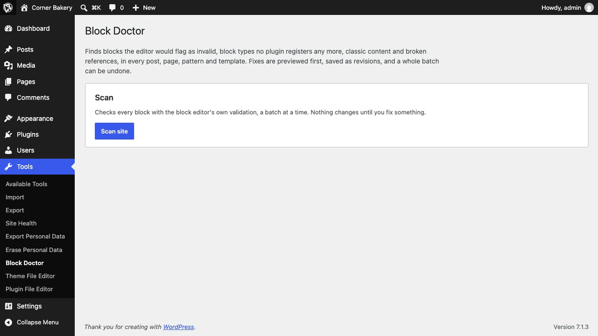
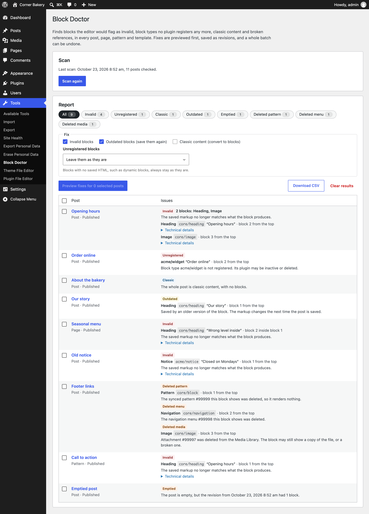
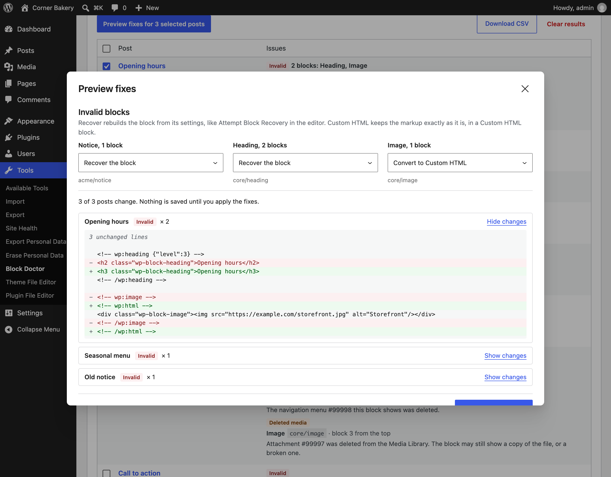
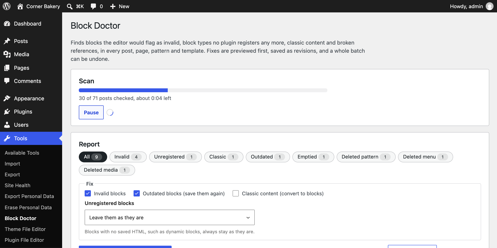
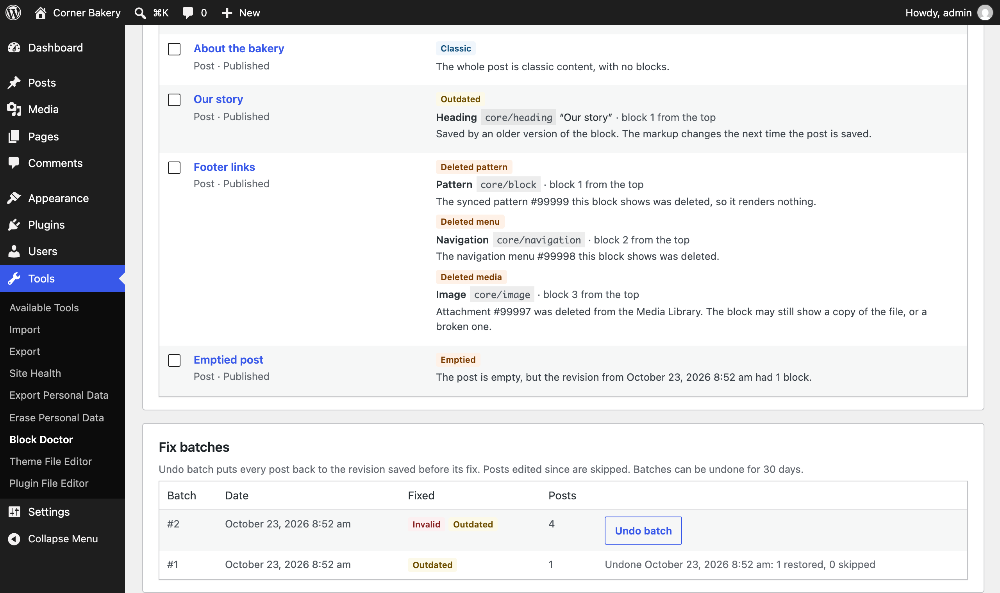

<p align="center"></p>

<h1 align="center">Block Doctor</h1>

<p align="center">
  <a href="https://playground.wordpress.net/?blueprint-url=https://raw.githubusercontent.com/aryanjasala/block-doctor/main/blueprint.json"></a>
  <a href="https://github.com/aryanjasala/block-doctor/releases/latest"></a>
  
  
  <a href="LICENSE.md"></a>
  <br>
  <a href="https://github.com/aryanjasala/block-doctor/actions/workflows/phpcs.yml"></a>
  <a href="https://github.com/aryanjasala/block-doctor/actions/workflows/phpstan.yml"></a>
  <a href="https://github.com/aryanjasala/block-doctor/actions/workflows/unit-tests.yml"></a>
  <a href="https://github.com/aryanjasala/block-doctor/actions/workflows/e2e-tests.yml"></a>
  <a href="https://github.com/aryanjasala/block-doctor/actions/workflows/plugin-check.yml"></a>
</p>

<p align="center">Finds every invalid, unregistered and broken block on the site and fixes them in bulk. A diff before anything is saved, and Undo batch after.</p>

<p align="center">
  
</p>

---

After a migration, a block plugin update or a plugin removal, posts open with "This block contains unexpected or invalid content". The editor fixes them one block at a time, and only when someone opens the post. Other tools only list the problems. Block Doctor checks every block on the site with the editor's own validation, then fixes them in bulk: a diff first, a revision for every save, and Undo batch for the whole run.

> [!NOTE]
> Free and open source under the GPL. No pro version, no upsells, no ads in wp-admin, no tracking. And it stays that way.

## Features

- **Whole-site scan** in the browser with the block editor's own validation, 20 posts at a time, with pause, resume after a reload, and how long is left
- **Finds** invalid blocks, unregistered block types, classic content, outdated markup, emptied posts, and references to deleted synced patterns, menus and media
- **Every post type** that uses the block editor, plus synced patterns, templates and template parts saved in the database, and blocks other plugins register
- **Bulk fixes** with a diff per post first: recover invalid blocks like Attempt Block Recovery, or keep them as Custom HTML per block type, convert classic content, save outdated blocks again
- **Only broken blocks change**: every other byte of the post stays as it was
- **Undo batch** restores every post from the revision saved before its fix, and skips posts edited since
- **CSV download**, a **dashboard widget**, a **Site Health** check, **WP-CLI**, **abilities** for AI agents, and PHP and JavaScript hooks for every default and event

## Install

1. Download `block-doctor.zip` from the [latest release](https://github.com/aryanjasala/block-doctor/releases/latest).
2. In WordPress, go to **Plugins > Add New Plugin > Upload Plugin**, choose the zip and activate it.

Or with WP-CLI:

```sh
wp plugin install https://github.com/aryanjasala/block-doctor/releases/latest/download/block-doctor.zip --activate
```

Needs WordPress 6.6+ and PHP 7.4+. To try it first, the **Try in WordPress Playground** badge opens a throwaway WordPress in your browser with the plugin and some demo content.

## Quick look

The server-side checks and the stored results work from the command line too:

```sh
wp block-doctor scan --format=table
wp block-doctor report --kind=invalid --format=csv > invalid.csv
wp block-doctor batches
wp block-doctor undo-batch 3
```

Invalid markup needs the browser, so finding and fixing it happens on **Tools > Block Doctor**.

## Screenshots

<table>
  <tr>
    <td width="50%" valign="top"><br><sub>The report after a scan: every kind of issue, per post, with the block and what is wrong with it</sub></td>
    <td width="50%" valign="top"><br><sub>The preview: a diff for every post, and a choice per block type between recovering the block and keeping it as Custom HTML</sub></td>
  </tr>
  <tr>
    <td width="50%" valign="top"><br><sub>A scan in progress, with how many posts are left and about how long it takes</sub></td>
    <td width="50%" valign="top"><br><sub>Fix batches, each with Undo batch</sub></td>
  </tr>
</table>

## Documentation

| Doc | What it covers |
| --- | --- |
| [Reference](docs/REFERENCE.md) | How the scan and the fixes work, PHP and JavaScript hooks, abilities, WP-CLI, REST routes and what is stored |
| [Development](docs/DEVELOPMENT.md) | Local setup, commands and tests |
| [Contributing](docs/CONTRIBUTING.md) | Pull requests, required checks and PR titles |
| [Releasing](docs/RELEASING.md) | How merged pull requests become releases |
| [Security](docs/SECURITY.md) | Reporting a vulnerability |
| [readme.txt](readme.txt) | What WordPress.org shows, with the FAQ and changelog |

## Project structure

```
block-doctor.php           plugin header and PSR-4 autoloader
src/
├── Plugin.php             creates the services
├── Config.php             defaults and their filters
├── Posts.php              which posts to scan, in ID order
├── Checks.php             the server-side checks
├── Scanner.php            browser scan progress, server scan, WP-Cron
├── Issues.php             stored results and the index
├── Fixer.php              saving fixes and Undo batch
├── Batches.php            fix batches
├── Report.php             summary, CSV and WP-CLI rows
├── Rest/Controller.php    routes for the screen
├── Admin/                 Tools > Block Doctor and the dashboard widget
├── Health/SiteHealth.php  the Site Health check
├── Abilities.php          abilities for AI agents
└── Cli/Command.php        wp block-doctor
assets/
├── js/doctor.js           scan, repair and diff logic, no WordPress globals
├── js/admin.js            the screen
└── admin.css
tests/
├── Unit/                  PHPUnit
├── js/                    Node tests for doctor.js
└── e2e/                   Playwright specs and the Docker site
.wordpress-org/            screenshots, icon and banner
docs/                      reference, development, contributing, releasing
```

## More free plugins

Small plugins that each fill one gap in WordPress, all free with no pro version:

| | Plugin | What it does |
| --- | --- | --- |
|  | [Page Template Usage](https://github.com/aryanjasala/page-template-usage) | See which template every page uses, and fix the pages on a missing template |
|  | [Staging Guard](https://github.com/aryanjasala/staging-guard) | Stops staging copies from emailing real people or getting indexed |
|  | [Category & Tag Trash](https://github.com/aryanjasala/category-tag-trash) | A trash for categories, tags and custom terms, with undo and full restore |
|  | [Site Read-Only Mode](https://github.com/aryanjasala/site-read-only-mode) | Read-only mode for WordPress during migrations and deploys |
|  | [Restore Blocks from Revisions](https://github.com/aryanjasala/restore-blocks-from-revisions) | Restore a single block from an old revision, not the whole post |
|  | [Activity Log with Undo](https://github.com/aryanjasala/activity-log-with-undo) | An activity log where every change you can reverse has an Undo button |
|  | [Agent Governance](https://github.com/aryanjasala/agent-governance) | Hold risky AI agent calls for approval, preview what they change, and roll back a session |
|  | [Block Theme Ops](https://github.com/aryanjasala/block-theme-ops) | Find Site Editor changes that override your theme files, see the diff, reset them or send them to Git |
|  | [Role Right-Sizer](https://github.com/aryanjasala/role-right-sizer) | Recommends the smallest role each user needs, from what they actually do |
|  | [Update Rehearsal](https://github.com/aryanjasala/update-rehearsal) | Try plugin, theme, core and PHP updates on a disposable copy of your site in WordPress Playground first |
|  | [User Session Manager](https://github.com/aryanjasala/user-session-manager) | See every device signed in, sign out one, and limit sessions per role |

## License

Copyright Aryan Jasala. Licensed under [GPL-2.0-or-later](LICENSE.md).
